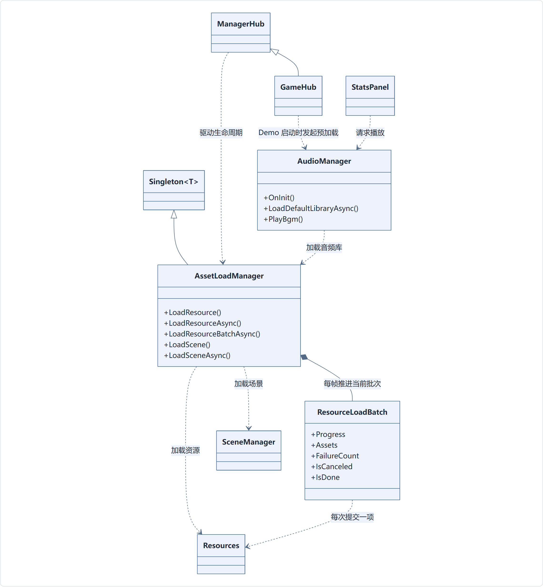
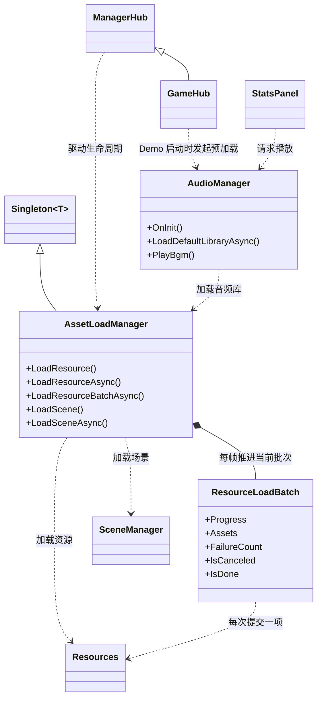
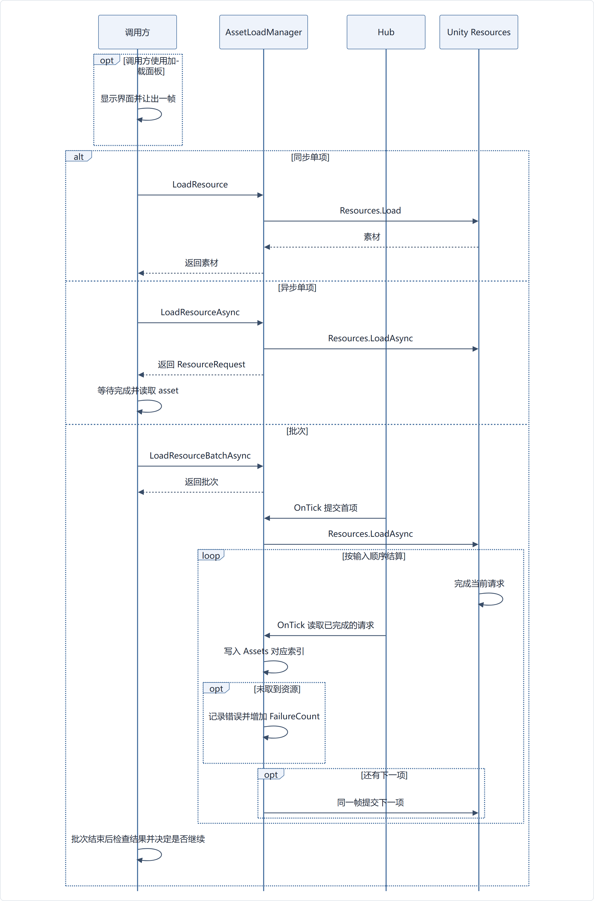
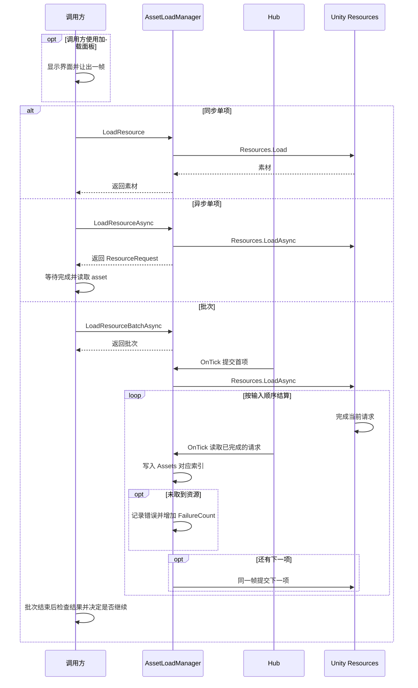
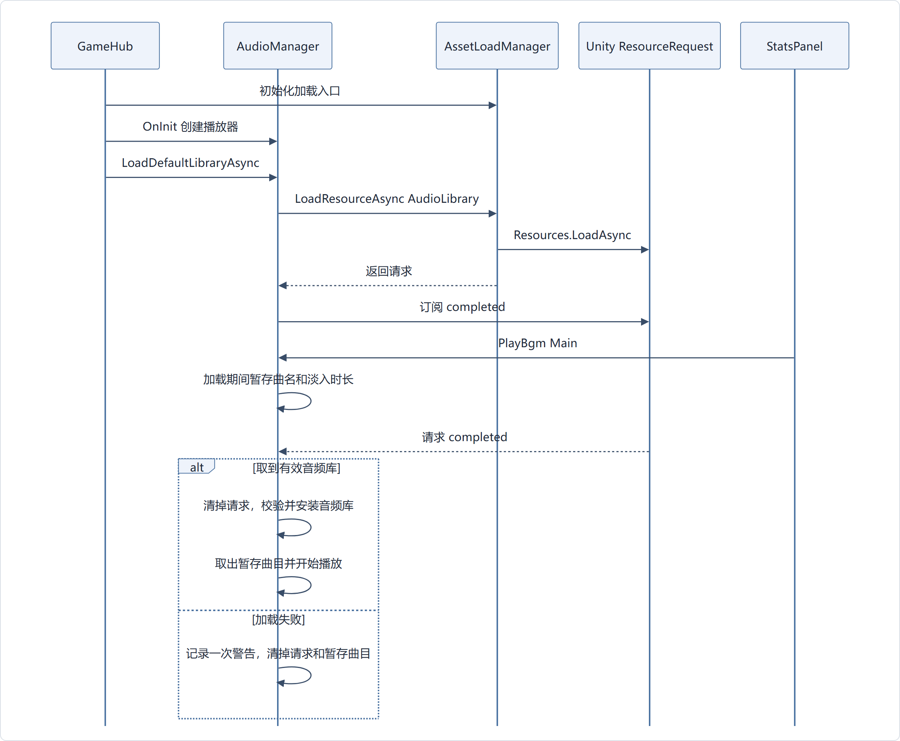
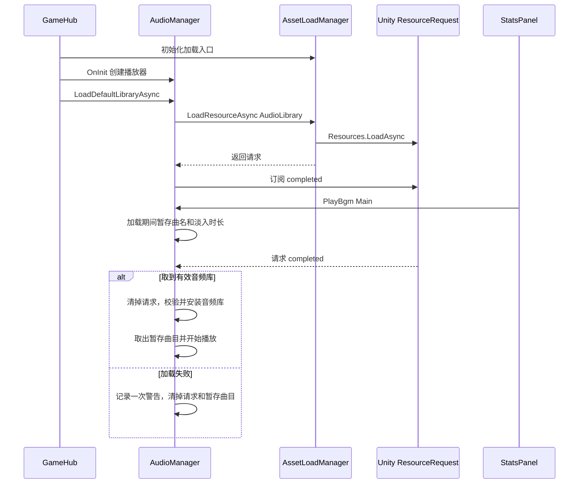
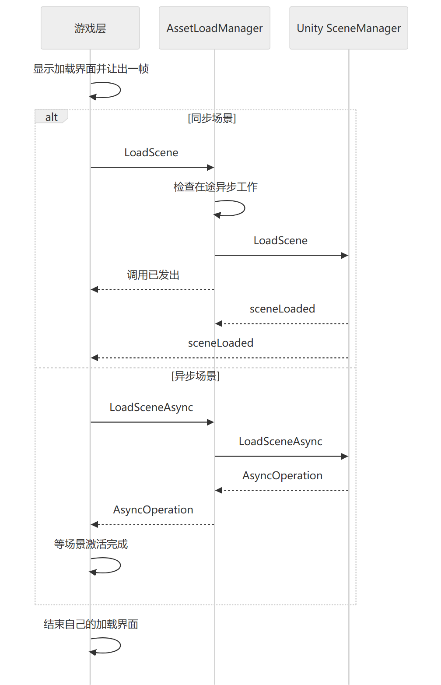
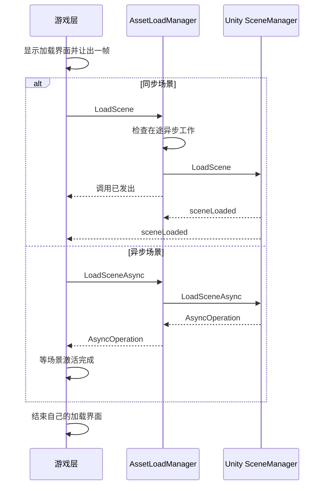

# AssetLoadManager 技术设计

`AssetLoadManager` 提供 Unity `Resources` 和场景的同步、异步加载入口。它依赖 `ManagerOfManagers.Core` 和 Unity 运行时。调用方选择加载时机，例如游戏层的 `LoadingPanel` 可以先显示界面，再发起本次需要的加载并等待结果。

## 类图

Mermaid 源码

## 接口

| 接口 | 返回值和完成时机 |
| --- | --- |
| `LoadResource<T>(path)` | 同步返回资源。找不到匹配的资源或参数无效时返回 `null`。 |
| `LoadResourceAsync<T>(path)` | 发出 Unity `ResourceRequest`。等它结束后，通过 `request.asset as T` 取结果。请求被拒绝时返回 `null`。 |
| `LoadResourceBatchAsync<T>(paths)` | 返回可在协程中等待的批次。用 `Assets` 按输入索引取结果，用 `FailureCount` 读取失败数。 |
| `LoadScene(buildIndex, mode = Single)` | 使用 Unity 同步场景入口。`true` 表示调用已发出，场景就绪以 `sceneLoaded` 为准。 |
| `LoadSceneAsync(buildIndex, mode = Single)` | 返回 Unity `AsyncOperation`。`isDone` 包含场景激活完成。 |
| `AudioManager.LoadDefaultLibraryAsync()` | 返回新发出或正在进行的默认音频库请求，可用于显示进度。已有库或未发出请求时返回 `null`。 |

资源路径相对于 `Resources`，子目录用正斜杠，省略扩展名。场景参数使用当前构建配置中启用的场景索引。

## 行为规则

- **R01 初始化与依赖。** `Illu.AssetLoad` 引用 Core。`Illu.Audio` 通过 asmdef 引用 `Illu.AssetLoad`。`GameHub` 将资源管理器注册为 `Order = 5`，由 Hub 先初始化。加载入口从 Unity 主线程调用。
- **R02 加载时机。** 加载流程的调用方决定何时发请求、显示进度和结束界面。以设计中的 `LoadingPanel` 为例，显示界面并让出一帧后，再提交资源或场景请求。需要界面持续更新时使用异步入口。
- **R03 批次。** 一次推进一个批次。提交时复制并校验路径，按输入顺序逐项异步加载。缺项保留在 `Assets` 的原索引，计入 `FailureCount` 后继续。面板可在批次结算后决定缺失资源是否阻止进关。释放时标记 `IsCanceled`、结束等待并停止提交剩余条目。
- **R04 场景。** 同一时刻接收一个场景加载请求。同步场景请求发出后等 `sceneLoaded`，异步场景请求的进度和状态由 Unity 句柄提供。控制 `Single` 切换的界面或流程需要跨场景存活到任务完成。
- **R05 同步场景检查。** 同步场景加载前先检查本管理器发出的在途操作和批次。Unity 的同步场景入口可能强制完成先前的异步操作，因此遇到未完成的任务时返回 `false`。 [Unity LoadScene 说明](https://docs.unity.com/en-us/engine/6000.6/script-reference/unityengine/scenemanagement/scenemanager/loadscene)
- **R06 音频预加载。** `AudioManager.OnInit()` 创建播放器。启动流程显式调用 `LoadDefaultLibraryAsync()`，由 `AudioManager` 订阅 Unity 的 `completed` 并安装音频库。加载期间保存最近一次 BGM 请求，库可用后再按曲名播放。空库时直接跳过音效请求，默认库加载失败时在完成回调中记录警告。也可以用 `SetLibrary` 传入已加载好的库。 [Unity AsyncOperation.completed 说明](https://docs.unity.com/en-us/engine/6000.6/script-reference/unityengine/asyncoperation/completed)

Unity 的音频导入设置会影响长 BGM 的内存和解码成本。针对目标素材和平台测试 `Streaming`、`Preload Audio Data` 和 `Load In Background` 时，可参考对应的选项说明。 [Unity 音频导入设置](https://docs.unity.com/en-us/engine/6000.6/manual/audio/reference/class-audio-clip)

## 资源加载时序

Mermaid 源码

## 音频库启动时序

Mermaid 源码

图中展示播放请求先于异步加载完成的情况。Demo 在 `GameHub.Start()` 完成 Hub 初始化后发起预加载。接入游戏的 `LoadingPanel` 时，可以在显示界面之后用返回的请求显示进度。玩法和 Demo 面板直接发出播放指令，由 `AudioManager` 处理库状态。

## 场景加载时序

Mermaid 源码

## 验收例子

| 编号 | 操作 | 预期 |
| --- | --- | --- |
| A01 | 同步和异步读取已知 Resources 资源 | 两种方式得到相同资源 |
| A02 | 提交一批资源，包含一个缺失路径 | 缺失位置为 `null`，失败数为 1，批次进度最终为 1 |
| A03 | 批次仍在进行时请求同步切场景 | 请求返回 `false`，批次继续 |
| A04 | 同步和异步加载有效场景 | 同步能收到目标场景事件，异步能等到场景激活结束 |
| A05 | 初始化一个音频管理器，然后显式提交默认库 | 初始化完成后才有播放器，调用预加载后开始异步取库 |
| A06 | 加载期间请求播放 Main，再试一次提前 StopBgm | 库就绪时分别按请求开始播放或保持停止 |
| A07 | 默认库缺失，加载中及失败后重复请求播放 | 该次加载产生一条警告，空库时跳过播放 |

## Unity 实测

Unity 6.6 下 A01 至 A06 通过。Play Mode 中同步和异步资源返回相同音频库，批次结束后进度为 1，缺失项保留原索引。场景实测使用临时 Additive 场景，验证了同步和异步入口，以及批次仍运行时同步入口会拒绝请求。

Demo 启动后正常播放 Main。独立音频实例在显式调用预加载前保持空库，重复调用共用同一个 Unity 请求。加载途中发出的播放和停止请求按预期处理，外部注入的音频库也会保留。临时场景已移除，构建场景列表已校验恢复。

A07 在 Play Mode 通过。缺库请求完成后记录一次警告，反复请求 BGM、战斗音效和 UI 音效时没有产生播放错误。

## Unity API

- [Resources.LoadAsync](https://docs.unity.com/en-us/engine/6000.6/script-reference/unityengine/resources/loadasync)
- [SceneManager.LoadSceneAsync](https://docs.unity.com/en-us/engine/6000.6/script-reference/unityengine/scenemanagement/scenemanager/loadsceneasync)
