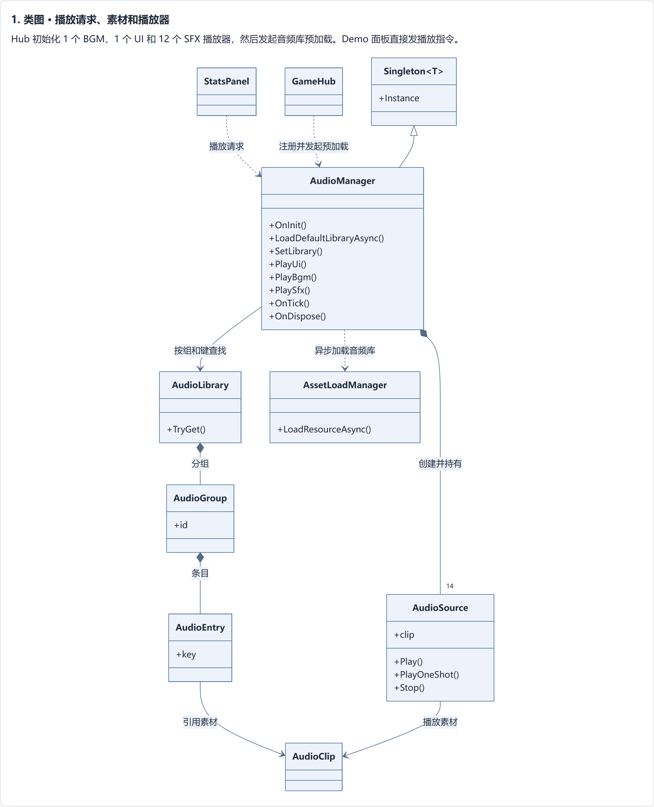
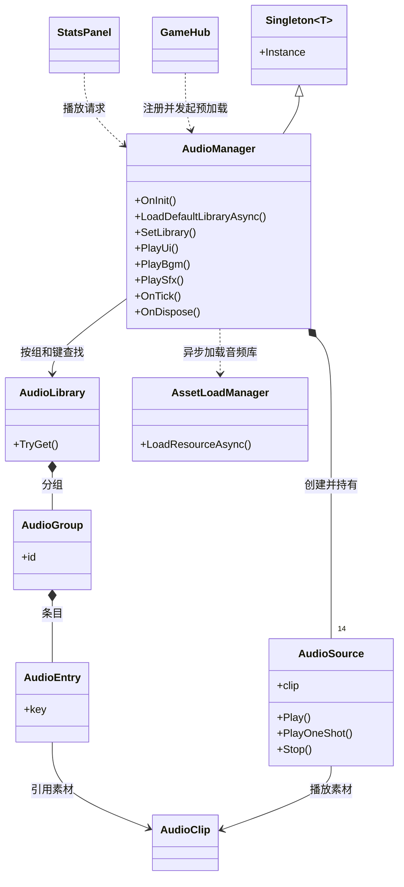
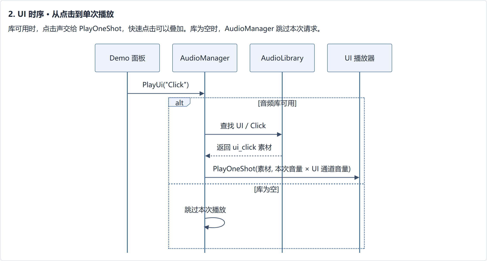
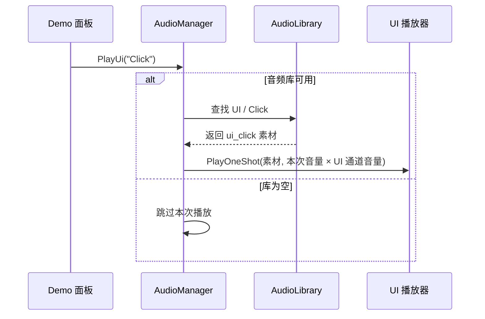
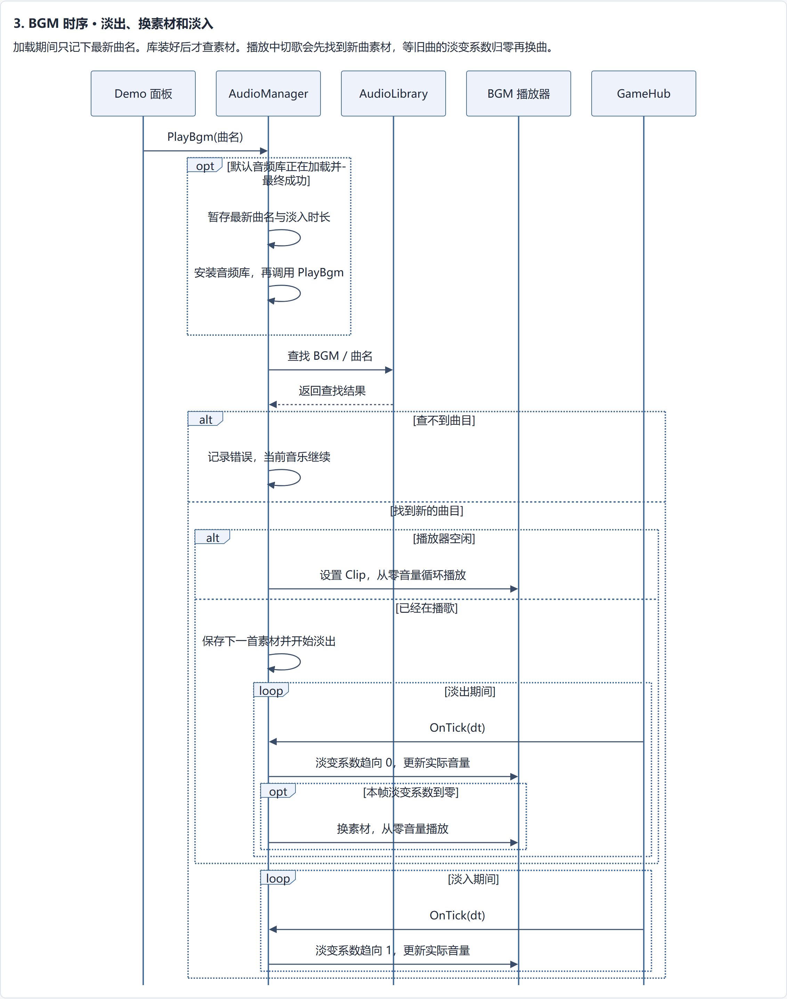
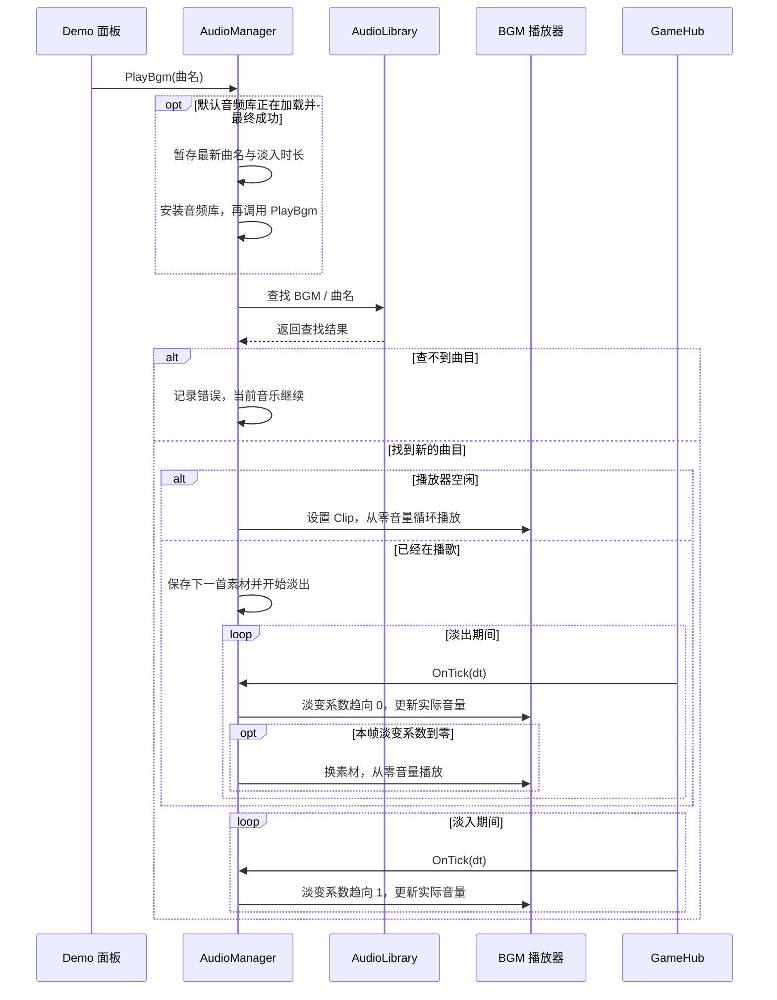
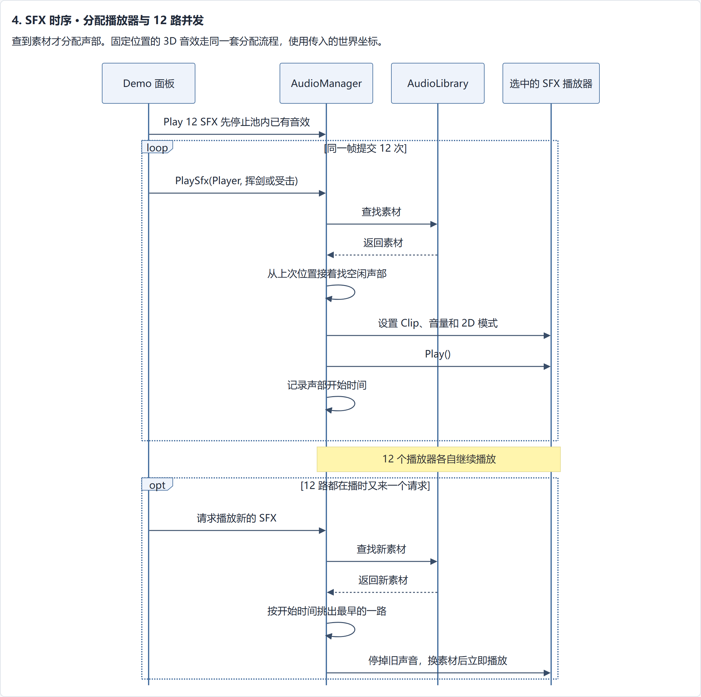
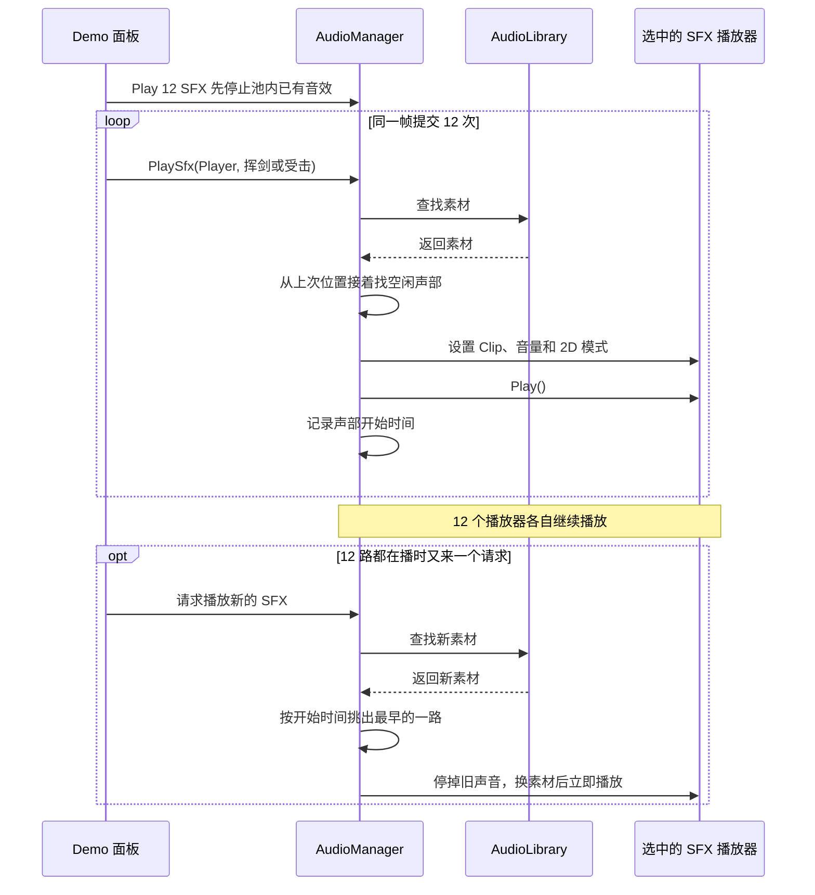

# AudioManager 类图与时序图

音频库的异步启动流程见 [资源加载设计](../assetloadmanager/AssetLoadManager.md#音频库启动时序)。

## 类图 · 播放请求、素材和播放器

Hub 初始化 1 个 BGM、1 个 UI 和 12 个 SFX 播放器，然后发起音频库预加载。Demo 面板直接发播放指令。

Mermaid 源码

## UI 时序 · 从点击到单次播放

库可用时，点击声交给 PlayOneShot，快速点击可以叠加。库为空时，AudioManager 跳过本次请求。

Mermaid 源码

## BGM 时序 · 淡出、换素材和淡入

加载期间只记下最新曲名。库装好后才查素材。播放中切歌会先找到新曲素材，等旧曲的淡变系数归零再换曲。

Mermaid 源码

## SFX 时序 · 分配播放器与 12 路并发

查到素材才分配声部。固定位置的 3D 音效走同一套分配流程，使用传入的世界坐标。

Mermaid 源码

