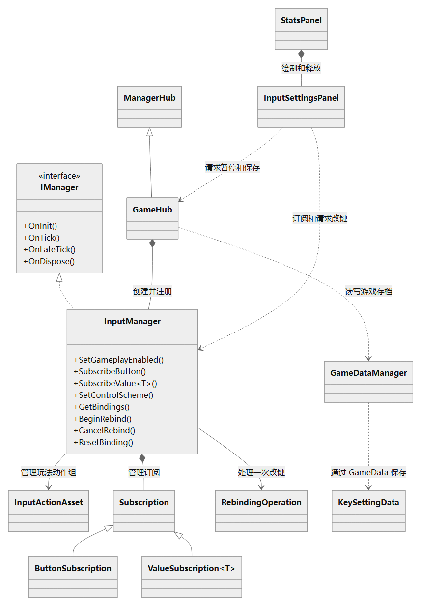
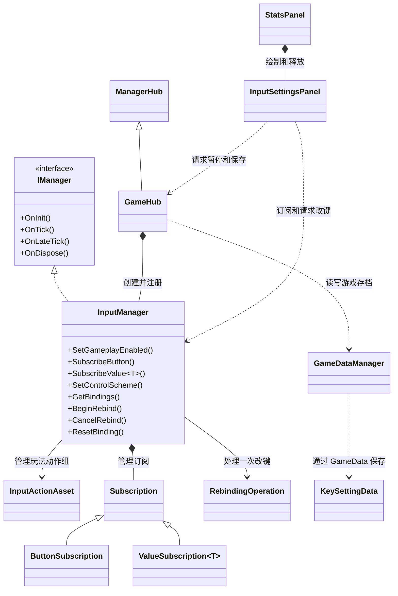
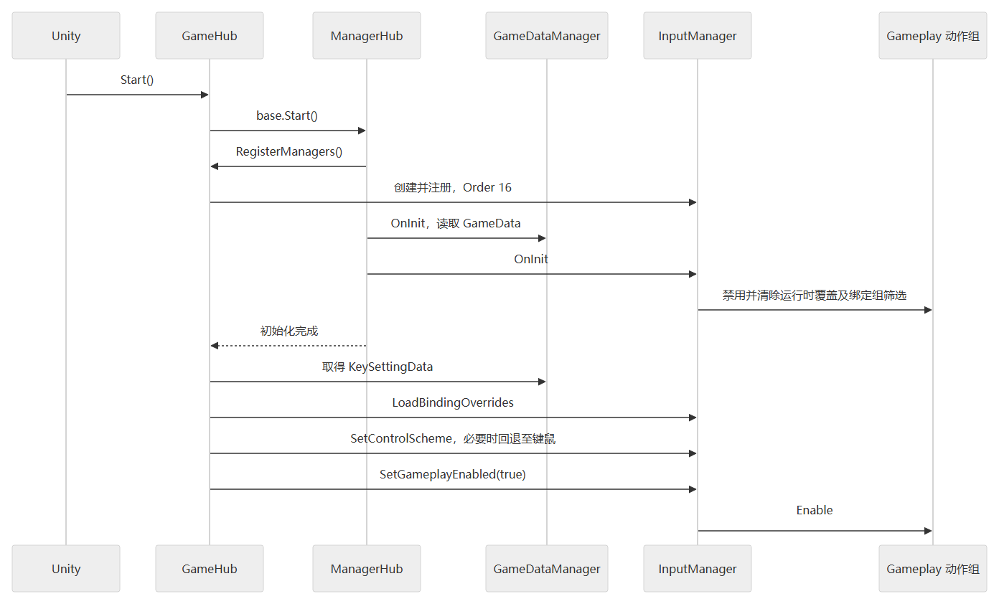
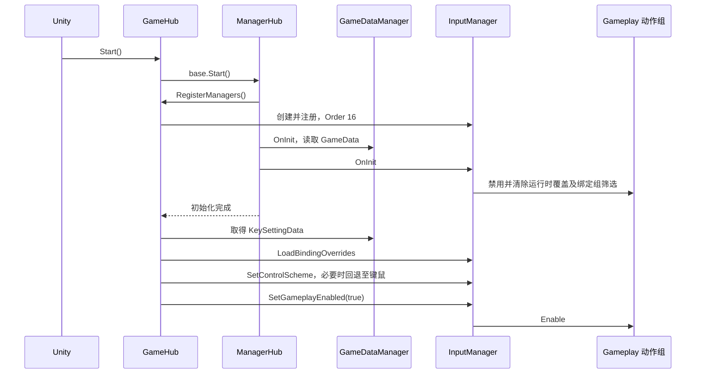
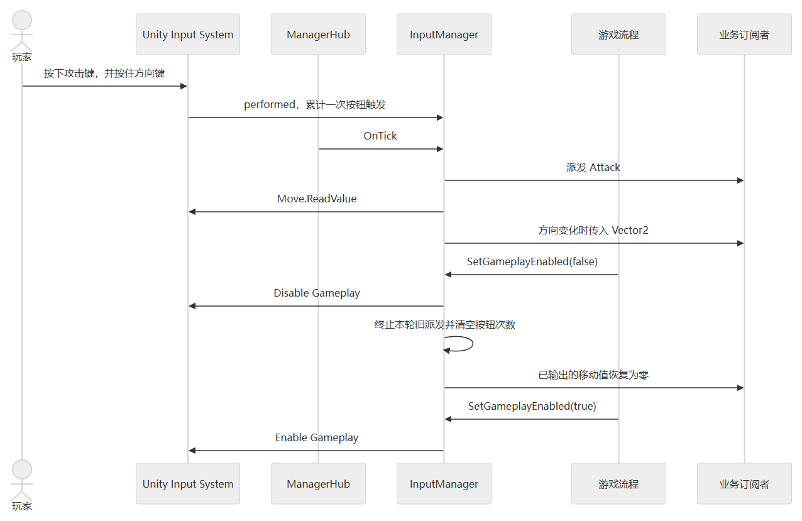
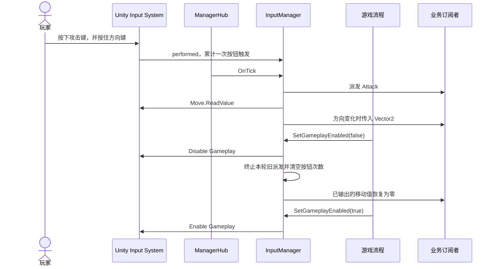
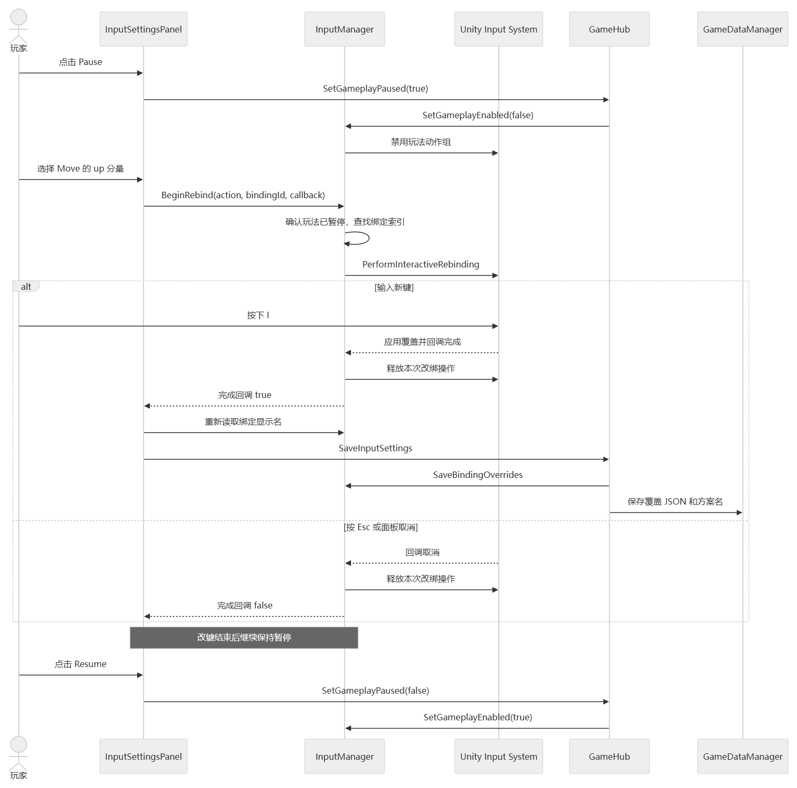
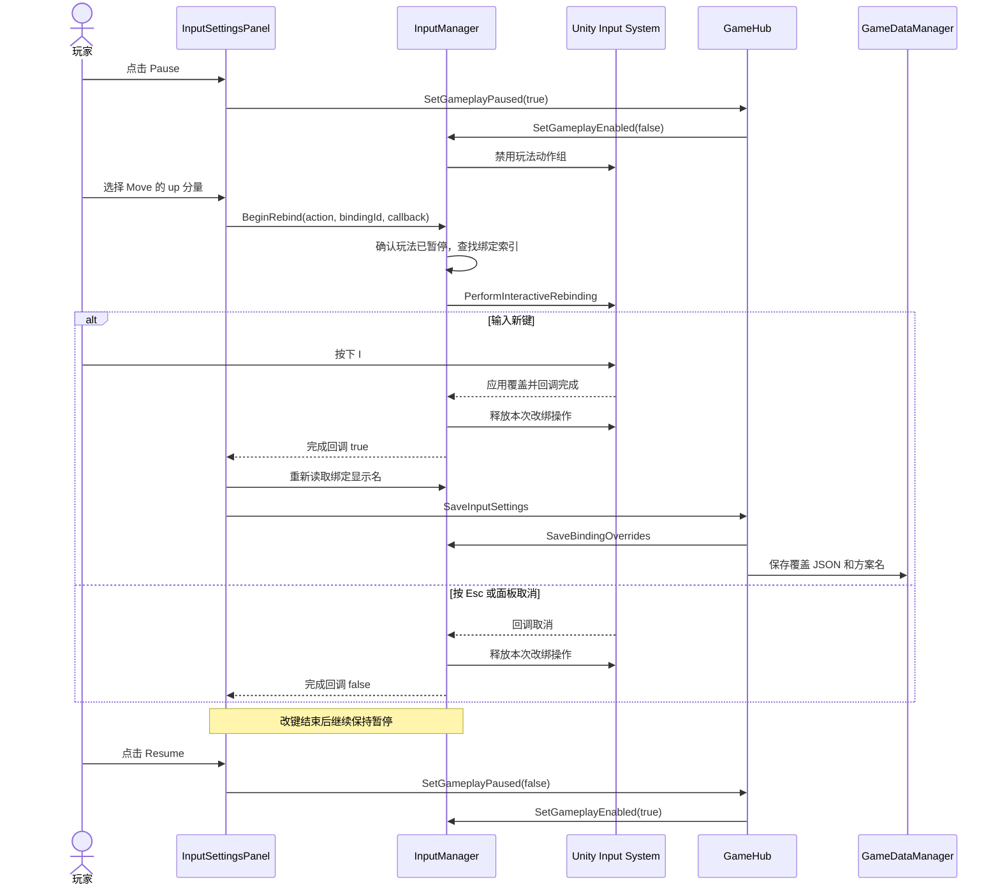

# InputManager 实现说明

`InputManager` 是由游戏的 `GameHub` 统一驱动的纯 C# Manager。它使用项目提供的独立玩法动作资产，向角色等业务代码提供按钮触发和连续值。全项目输入资产可继续承载 UI 动作。文中的 `StatsPanel`、`InputSettingsPanel`、`GameDataManager` 和 `KeySettingData` 来自验证项目 `ManagerOfManagersTest`，用于演示在游戏层接入。

## 类图



<details>
<summary>Mermaid 源码</summary>



</details>

`Illu.Input` 的程序集依赖为 `ManagerOfManagers.Core` 和 `Unity.InputSystem`。项目层负责资源引用、初始方案和存档。SampleScene 中的 Manager 按 `GameDataManager(15) → InputManager(16) → AudioManager(18)` 依次初始化。

## 先认清三个对象

| 对象 | 在 Demo 里的例子 | 解决的问题 |
| --- | --- | --- |
| Action Map，动作组 | `Gameplay` | 一次开启或关闭整组玩法输入 |
| Action，动作 | `Attack`、`Move` | 游戏代码接收什么意图或数值 |
| Binding，绑定 | `<Mouse>/rightButton`、`<Keyboard>/w` | 哪个设备控件触发动作 |

`Move` 的键盘绑定是组合绑定，Unity 把上下左右合成为一个 `Vector2`。手柄左摇杆直接给同一个动作提供 `Vector2`。两套方案用各自的绑定组区分，业务回调可以复用。

## 启动与读档时序



<details>
<summary>Mermaid 源码</summary>



</details>

`GameHub.Start()` 先执行 `base.Start()`。读档和准备动作组都完成后，才导入玩家键位、选择方案、开启玩法输入。这也使再次进入 Play Mode 时能从存档或资产默认值重新起步。

## 派发与暂停时序



<details>
<summary>Mermaid 源码</summary>



</details>

按钮回调先记到 `ButtonSubscription._pending`，下一次 `OnTick` 逐次派发。向量由 `ValueSubscription<T>.Tick()` 采样，只在值变化时通知。暂停会立即清空按键次数，同时把已输出的向量置零。暂停可能发生在业务回调里，此时 `_inputRevision` 变化，当前派发循环收尾，旧输入不会继续传给后面的订阅者。

退出游戏时，`IManager.OnDispose()` 先撤销开启条件，再关动作组、取消当前改绑、解绑回调。玩法资产始终由 Unity 管理。

## 改绑与存档时序



<details>
<summary>Mermaid 源码</summary>



</details>

`GetBindings()` 返回绑定标识、分量名和显示名。组合绑定的父项用于定义合成方式，设置界面逐条显示可改键的分量。以键盘的 `up` 为例，`W` 和上箭头原本是两条独立绑定，所以把 `W` 改成 `I` 后，上箭头仍然有效。

游戏流程先禁用玩法输入，`BeginRebind()` 才会按标识重新定位当前绑定并启动改键。改绑成功时 Unity 写入运行时覆盖，取消则保留当前键位。面板成功改键、还原或切换方案后，由 `GameHub` 把覆盖 JSON 和方案名写入 `KeySettingData`。成功或取消都只结束改键操作。Demo 由玩家点击 **Resume** 来恢复玩法输入。

## 开发者接入

按 [README 的安装顺序](../../README.md) 添加 Core 和输入包。输入包要求 Unity 6000.6，依赖 Unity Input System 1.20.0。在 Player Settings 中启用 Input System Package，然后通过 Inspector 把独立的玩法资产交给 Hub。

```csharp
using Illu.Input;
using ManagerOfManagers.Core;
using UnityEngine;
using UnityEngine.InputSystem;

public sealed class GameHub : ManagerHub
{
    [SerializeField] InputActionAsset gameplayActions;

    public InputManager Input { get; private set; }

    protected override void RegisterManagers()
    {
        Input = new InputManager(gameplayActions);
        Register(Input);
    }

    protected override void Start()
    {
        if (Instance != this)
            return;

        base.Start();
        // 本例的动作资产中已有 Keyboard&Mouse 方案。可在这里恢复游戏存档。
        Input.SetControlScheme("Keyboard&Mouse");
        Input.SetGameplayEnabled(true);
    }
}
```

`Gameplay` 是构造函数默认管理的动作组名，默认 `Order` 为 16。其他命名或顺序可在创建时传入参数。

1. 在 `Gameplay.inputactions` 中添加动作，并在各方案下配置相应绑定。一次性的动作选 `Button`，移动方向这类连续值选 `Value` 和 `Vector2`。
2. 在业务脚本声明 `InputActionReference` 字段，从 Inspector 引用动作。等 Hub 初始化完成，再调用订阅接口。
3. 由业务代码决定怎么执行。以移动为例，订阅回调只记录最新方向，角色的更新循环再用这个方向移动。场景对象退出时，调用句柄的 `Dispose()`。

```csharp
_attackSubscription = input.SubscribeButton(attackAction, Fire);
_moveSubscription = input.SubscribeValue<Vector2>(moveAction, direction => _direction = direction);
```

在验证项目 `ManagerOfManagersTest` 的 `SampleScene` 中，进入 Play Mode 后可以使用 **Gameplay Input** 面板。用 `WASD` 检查 Move，按 `Q` 检查 Dash，移动鼠标看 Aim，按鼠标右键或 Enter 检查 Attack。面板的改键列表覆盖 Move 和 Attack，四个动作都演示了订阅。先点 **Pause**，再点 **Rebind**，完成或取消后用 **Resume** 恢复玩法输入。

## 在 UI 上显示按键

等 Hub 恢复好玩家键位和控制方案后，通过动作引用查询。示例使用当前方案的第一条有效绑定。显示多个键时可遍历列表。玩家完成改键或切换方案后，刷新已有提示。

```csharp
var bindings = input.GetBindings(interactAction, input.CurrentControlScheme);
if (bindings.Count > 0)
    hintLabel.text = $"按 {bindings[0].DisplayName} 交互";
```

`DisplayName` 用于画面上的键名，`Id` 用于定位改绑或还原的绑定。

## 验收记录

| 规则 | Play Mode 验收 |
| --- | --- |
| R01 动作扩展 | 模拟键鼠和手柄验证 Move、Aim、Attack、Dash 的采样和派发 |
| R02 启停 | 按住移动再暂停时方向归零，暂停期间按键和点击没有触发攻击，重新进入 Play Mode 后输入正常启用 |
| R03 交互改绑 | 玩法开启时拒绝开始改键。暂停后可将 `W` 改成 `I`，其他方向及手柄仍有效，可恢复 `W`。改绑成功或按 Esc 取消后由游戏流程恢复输入 |
| R04 方案与存档 | 模拟切换验证两套绑定隔离，绑定覆盖及方案通过项目 JSON 格式读回 |

按键与摇杆由 Unity 模拟设备送入，实体手柄仍待实测。 [交互式改绑](https://docs.unity3d.com/Packages/com.unity.inputsystem@1.20/manual/interactive-rebinding.html) · [覆盖保存与恢复](https://docs.unity3d.com/Packages/com.unity.inputsystem@1.20/manual/save-load-rebinds.html)

## 源码入口

- [InputManager.cs](../../com.illu.input/Runtime/InputManager.cs) 提供订阅、动作组启停、方案和改绑接口。
- [ManagerHub.cs](../../com.illu.managerofmanagers/Runtime/ManagerHub.cs) 负责 Manager 的初始化、每帧调度和退出时的清理。